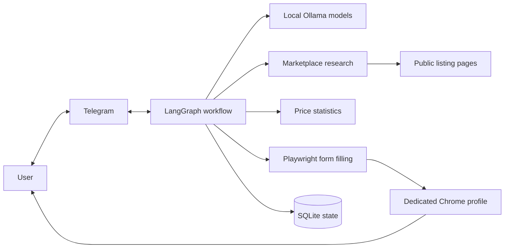

# Marketplace Listing Agent

Marketplace Listing Agent is a local, human-controlled assistant for creating
second-hand marketplace listings. It helps identify an item from photos and notes,
research current asking prices, write the listing, and fill forms on OLX, Allegro
Lokalnie, and Vinted.

The user reviews every important decision. The application never clicks the final
Publish button.

## How it works

1. The user sends photos and notes through a private Telegram bot.
2. A local model extracts facts such as brand, model, condition, defects, and accessories.
3. The user confirms or corrects each fact.
4. The application searches marketplace pages for comparable listings.
5. It verifies the pages and calculates price statistics from accepted comparisons.
6. The user chooses a quick-sale, typical, patient, or custom price.
7. A Polish-language model creates a separate draft for each marketplace.
8. A second model and deterministic rules check the drafts for unsupported claims.
9. Playwright fills the selected forms in a dedicated Chrome profile.
10. The user checks everything and publishes manually.

## Architecture



The code is divided into small layers with clear responsibilities:

| Layer | Responsibility |
|---|---|
| `workflow` | Process order, saved state, pauses, and user approvals |
| `models` | Local model roles, structured output, fallback, and memory control |
| `research` | Search discovery, page verification, comparison, and integrity checks |
| `domain` | Item facts, category profiles, pricing rules, and data models |
| `browser` | Form mapping, filling, read-back, and screenshot evidence |
| `channels` | Telegram messages and approval commands |
| `evaluation` | Golden datasets, quality metrics, latency, and model reports |

LangGraph defines the workflow explicitly. SQLite checkpoints let the process pause
for a decision and continue later without repeating completed work. Models run one at
a time through Ollama so they can share the available memory.

## Local models

| Task | Default model |
|---|---|
| Fact extraction and search planning | Qwen 3.5 9B, with 4B fallback |
| Comparable-listing and copy audit | Qwen 3.5 9B, with 4B fallback |
| Polish listing drafts | Bielik 11B v3 |
| Visual form fallback | Qwen 3.5 4B |

Model responses are validated with Pydantic schemas. Models help plan searches and
judge product similarity, but they do not calculate the final price statistics.
Median, trimmed mean, percentiles, counts, and recommendations are calculated by
regular Python code.

## Price research

The research process discovers candidate listings, opens each result, extracts its
price and status, and rejects mismatched products. Category profiles help distinguish
important variants, including:

- Fujifilm X lens versions and features such as XF/XC, WR, OIS, LM, and aperture;
- Nintendo Switch, Switch OLED, Switch Lite, model codes, controller drift, and bundles;
- Switch game title, edition, physical format, box, region, and used DLC codes;
- Apple model, year, chip, memory, storage, battery, and activation-lock status.

Only verified and accepted listings enter the calculation. The result includes price
counts, sources, sample size, and a confidence level. Active listing prices are
treated as asking prices, not confirmed transaction prices.

## Safety

- Every fact, marketplace, price, and draft requires user approval.
- Browser automation cannot click publishing controls.
- Research and signed-in marketplace sessions use separate browser contexts.
- Web content is treated as untrusted data and cannot control the workflow.
- URL and DNS checks block local networks, unsafe schemes, credentials, and unusual ports.
- Accepted comparisons are opened again before entering the price calculation.
- Conflicting or changed evidence is quarantined.
- Serial numbers and device identifiers are removed before web search and draft generation.
- Telegram accepts commands from one configured chat ID.
- The Telegram token can be stored in macOS Keychain.

These controls detect specific inconsistencies. They do not guarantee protection
against every form of dynamic cloaking or future marketplace changes.

## Requirements

- macOS
- Python 3.12 or newer
- [uv](https://docs.astral.sh/uv/)
- Google Chrome
- [Ollama](https://ollama.com/)
- a private Telegram bot

## Setup

```bash
uv sync --extra dev
cp .env.example .env

ollama pull qwen3.5:4b
ollama pull qwen3.5:9b
ollama pull hf.co/speakleash/Bielik-11B-v3.0-Instruct-GGUF:Q4_K_M

uv run marketplace-listing-agent doctor
uv run marketplace-listing-agent configure-token
uv run marketplace-listing-agent run
```

Set the numeric Telegram chat ID in `.env`:

```dotenv
MARKETPLACE_AGENT_TELEGRAM_ALLOWED_CHAT_ID=123456789
```

The token should be configured with the command above so it is stored in Keychain
instead of the repository.

## Tests and model evaluation

```bash
uv run ruff check src tests examples
uv run pytest

uv run marketplace-listing-agent eval --suite facts
uv run marketplace-listing-agent eval --suite comparables
uv run marketplace-listing-agent eval --suite copy
uv run marketplace-listing-agent eval --suite copy_audit
uv run marketplace-listing-agent eval --suite forms
uv run marketplace-listing-agent eval --suite price_math
```

The datasets in `goldens/` are small synthetic starting sets. Local JSON reports
contain structured model output, quality metrics, latency, token counts, and load
time. Generated reports are ignored by Git.

## Current limitations

- Marketplace form adapters are beta and still require tests with signed-in accounts.
- CAPTCHA, expired sessions, unknown fields, and failed read-back require user action.
- Marketplace page structure, access rules, and terms can change.
- Price research mainly observes asking prices.
- Consistent dynamic cloaking across repeated automated visits may not be detected.
- Model evaluation needs more real, manually labelled examples.
- Photos sent through Telegram are not local during transport. Processing and model
  inference happen locally after download.

## Documentation

- [Architecture](docs/ARCHITECTURE.md)
- [Operations](docs/OPERATIONS.md)
- [Category profiles](docs/CATEGORY_PLAYBOOKS.md)
- [Security and dynamic cloaking](docs/SECURITY.md)
- [Evaluation baseline](docs/EVALUATION_RESULTS.md)
- [Technical decisions](docs/adr/)
- [LangGraph learning path](docs/course/00_START.md)
