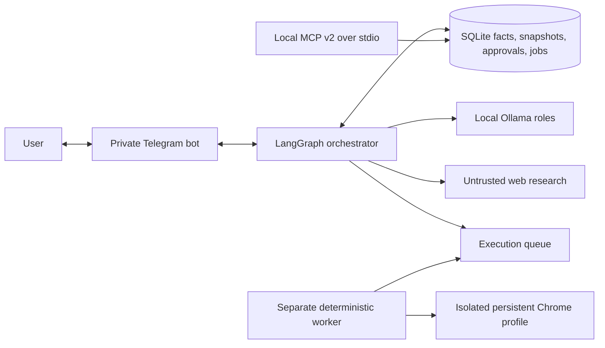

# Marketplace Listing Agent

A local-first, human-controlled assistant for researching prices and preparing Polish
second-hand listings. It combines explicit LangGraph orchestration, local Ollama models,
evidence-based pricing, immutable approvals, SQLite jobs, a separate browser worker,
and a narrow MCP server.

OLX is the first execution target and Allegro Lokalnie is the second. Vinted is disabled.
The signed-in adapters still require controlled validation against current real forms.
Live submission is disabled by default.
The official OLX Partner API is the preferred long-term adapter after OLX approves the
application; Allegro Lokalnie explicitly does not support publication through Allegro API.

## Data flow



The user approves facts, portals, price and copy. Approved content and photo hashes form
an immutable snapshot. Form preparation requires a snapshot-bound one-time approval.
Publication requires a second approval after successful browser readback. A timeout after
submit becomes `unknown`; reconciliation reads portal state before any retry.

## Safety properties

- Models propose data; deterministic code grants authority and computes price statistics.
- A shared admission gate rejects unverified, suspicious, non-PLN and non-item prices.
- Active asking prices and explicitly sold listings are reported separately.
- Web content cannot select tools or publication actions.
- URL and DNS checks reject private, loopback, link-local and special destinations.
- CAPTCHA, login expiry, unknown fields, manual differences and unexpected fees pause one job.
- Passwords, OTPs, cookies and card data never enter Telegram, models, MCP or reports.
- Monitoring stores operational metadata, prompt hashes and error types, without prompt text.
- Exact snapshot hashes, one-time tokens and transactional job claims limit stale/replayed work.

These controls have defined limits. Unit and fixture tests do not prove that a current,
signed-in marketplace form works or that a real listing was published.

## Requirements and setup

- macOS on Apple Silicon
- Python 3.12+
- [uv](https://docs.astral.sh/uv/), Google Chrome and [Ollama](https://ollama.com/)
- a private Telegram bot for the conversational interface

```bash
uv sync --locked --extra dev --no-editable
cp .env.example .env

ollama pull qwen3.5:4b
ollama pull qwen3.5:9b
ollama pull hf.co/speakleash/Bielik-11B-v3.0-Instruct-GGUF:Q4_K_M

.venv/bin/marketplace-listing-agent doctor --scope all
.venv/bin/marketplace-listing-agent manifest --destination environment-manifest.json
.venv/bin/marketplace-listing-agent configure-token
.venv/bin/marketplace-listing-agent run
```

Set only the allowed numeric chat ID in `.env`. Store the bot token through
`configure-token`, which uses macOS Keychain.

Run the browser worker as a separate process:

```bash
.venv/bin/marketplace-listing-agent worker
```

Live submit stays off unless `MARKETPLACE_AGENT_ALLOW_LIVE_SUBMIT=true` is explicitly
set for a controlled, approved run. `/wystaw JOB_ID` first renders the exact final
snapshot and issues a one-time publication approval.

## Quality checks

```bash
.venv/bin/ruff check .
.venv/bin/pytest
.venv/bin/python scripts/validate_jsonl.py
.venv/bin/python scripts/scan_secrets.py
uv build
docker compose config --quiet
```

GitHub Actions runs locked installation, lint, tests, data and secret validation,
dependency audit, package build, and an installed-wheel smoke test. It does not use
accounts, Chrome sessions or model downloads.

## MCP

```bash
.venv/bin/marketplace-listing-agent-mcp
```

The MCP Python SDK v2 server uses local `stdio`. Read tools expose item state, approved
snapshots and pricing summaries. Execution tools accept identifiers only and re-check
the same SQLite authorization rules used by Telegram.

## LoRA experiment

A real MLX-LM LoRA run trained Qwen3-0.6B on 240 synthetic examples and evaluated 30
held-out product-family cases. The adapter fixed the base model's JSON-echo behavior,
but only tied a deterministic template. It is documented and reproducible, but not
enabled in the product. See [experiment results](experiments/lora/RESULTS.md).

## Documentation

- [Architecture](docs/ARCHITECTURE.md)
- [Security model](docs/SECURITY.md)
- [Operations](docs/OPERATIONS.md)
- [Implementation walkthrough](docs/WALKTHROUGH.md)
- [Technical learning textbook in Polish](docs/course/PODRECZNIK_TECHNICZNY.md)
- [Competency and evidence matrix](docs/COMPETENCY_MATRIX.md)
- [Model failure atlas](docs/FAILURE_ATLAS.md)
- [Current verified status](docs/PROJECT_STATUS_2026-09-13.md)
- [Architecture decisions](docs/adr/)
