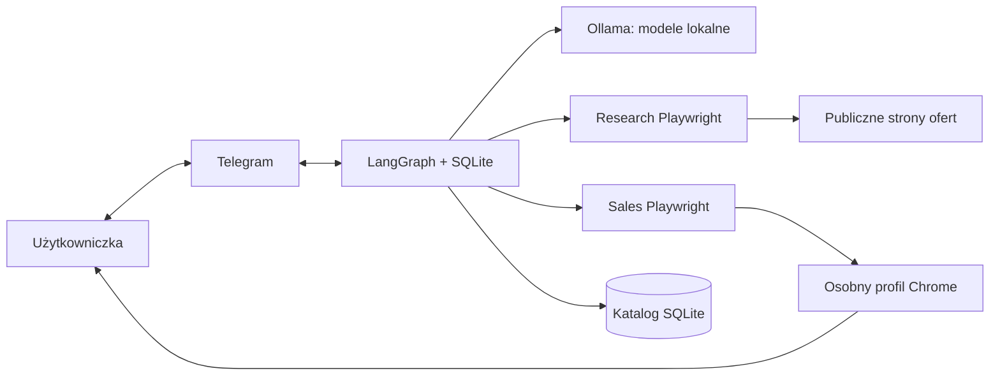
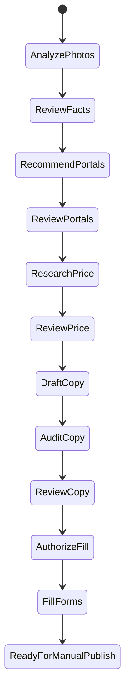

# Architektura Marketplace Listing Agenta

## Cel i granica autonomii

System automatyzuje pracę przygotowawczą, nie decyzję sprzedażową. Model może
proponować i mapować kontrolki. Kod Playwright wykonuje wyłącznie dozwolone akcje.
Użytkowniczka zatwierdza fakty, portale, cenę, każdą wersję tekstu i samo rozpoczęcie
wypełniania. Przycisk publikacji jest blokowany kodem i pozostaje ręczny.

Zdjęcia przechodzą przez Telegram, więc nie są w pełni lokalne w transporcie.
Po pobraniu analiza, modele, stan, preferencje i raporty pozostają na Macu.

## Warstwy i odpowiedzialności

| Warstwa | Odpowiada za | Nie odpowiada za |
|---|---|---|
| `channels` | rozmowę i tłumaczenie przycisków na decyzje | logikę procesu |
| `workflow` | kolejność, stan, pauzy, wznowienia | selektory stron |
| `models` | role, schematy, fallback, wyładowanie RAM | decyzje biznesowe |
| `research` | odkrywanie i weryfikację porównywalnych ofert | wymyślanie ceny |
| `domain` | fakty, reguły ceny, zapis przedmiotów | sieć i UI |
| `browser` | bezpieczne wypełnienie i odczyt kontrolny | publikację |
| `evaluation` | powtarzalne pomiary modeli i kodu | deklarowanie sukcesu bez danych |

Taki podział jest celowy: wymiana Telegrama na aplikację WWW nie zmienia grafu,
wymiana modelu nie zmienia statystyki, a zmiana selektora OLX nie dotyka domeny.

Szkic Bielika przechodzi dodatkowo przez audyt 9B i deterministyczny guard. Jeśli
którykolwiek wykryje niepoparte twierdzenie, użytkowniczka dostaje bezpieczny opis
szablonowy złożony wyłącznie z zatwierdzonych faktów oraz listę ostrzeżeń.

## Przepływ stanu

Każdy etap zatwierdzenia używa dynamicznego `interrupt`. Checkpointer zapisuje stan
pod `thread_id == item_id`. Telegram później wysyła `Command(resume=...)` z decyzją.
Node z modelem i node z zatwierdzeniem są rozdzielone, aby wznowienie nie powtarzało
kosztownej inferencji. Kod przed `interrupt` musi być deterministyczny i bez
nieodwracalnych efektów, bo LangGraph uruchamia node ponownie przy wznowieniu.

## Dlaczego nie „jeden wielki agent”

Jeden ogólny agent utrudnia testowanie, może mieszać fakty z sugestiami i sam wybrać
narzędzie o zbyt dużych uprawnieniach. Tu graf jest jawny, a swoboda modelu ograniczona
do czterech ról. Wynik każdej roli przechodzi walidację Pydantic. To daje ślad decyzji,
możliwość porównania modeli i przewidywalne punkty kontroli.

## Modele i RAM

| Rola | Domyślny model | Powód |
|---|---|---|
| `vision_fast` | `qwen3.5:9b`, fallback 4B | dokładniejsza analiza faktów i plan zapytań |
| `market_expert` | `qwen3.5:9b`, bez thinking | audyt przy akceptowalnym czasie lokalnym |
| `polish_copywriter` | Bielik 11B v3 GGUF Q4_K_M | naturalny polski tekst |
| `gui_fallback` | `qwen3.5:4b` | zrzut ekranu + kontrolki DOM |

Globalny lock w providerze uniemożliwia równoległą inferencję. `keep_alive: 30s`
zwalnia model krótko po odpowiedzi bez blokowania samego workflow. Dzięki temu 24 GB
pamięci służy kolejnym modelom zamiast kilku naraz. Pierwsze próby z natychmiastowym
`keep_alive: 0` powodowały długie oczekiwanie w stanie „Stopping”. Próba 27B wykazała,
że model mieści się (Ollama raportował 18 GB), ale nie dała ukończonego raportu.
Dlatego 9B jest modelem głównym dla faktów i rynku, 4B fallbackiem oraz modelem GUI,
a 27B wariantem eksperymentalnym. Na sześciu rozszerzonych goldenach 9B uzyskał
lepszy wynik niż 4B, choć oba nadal wymagają akceptacji faktów i rozwoju datasetu.

## Cena jako dowód, nie opinia LLM

1. Model buduje zapytania tylko z zatwierdzonych faktów.
2. Playwright odkrywa do 60 URL-i z kilku źródeł.
3. URL/DNS guard blokuje sieć lokalną, nietypowe porty i niebezpieczne przekierowania.
4. Weryfikator otwiera link i sprawdza cenę/status oraz zgodność metadanych.
5. Twarda bramka wymaga jawnej marki i modelu; profil sprawdza wariant kategorii.
6. Model ekspercki klasyfikuje pozostałą porównywalność bez dostępu do narzędzi.
7. Wybrane porównania są otwierane ponownie; niespójne trafiają do kwarantanny.
8. Deterministyczny Python liczy liczności, P25, medianę, średnią przyciętą i P75.
9. Użytkowniczka widzi np. `10 x 100 zł, 8 x 120 zł` i wybiera cenę.

Status `sold` jest używany tylko wtedy, gdy strona jawnie pokazuje sprzedaż. Zwykła
aktywna oferta jest ceną ofertową, nie dowodem ceny transakcyjnej. Surowe URL-e są
używane tylko w pamięci procesu i nie trafiają do katalogu ani checkpointu; zapisuje
się agregat. To ogranicza retencję i fałszywe poczucie trwałości linków.

## Automatyzacja formularza

Najpierw używane są stabilniejsze etykiety dostępności (`get_by_label`). Jeżeli pole
nie pasuje, fallback dostaje ograniczony opis kontrolek DOM i screenshot. Zwraca
plan w zamkniętym słowniku akcji. Wykonawca odrzuca niską pewność i słowa publikacji,
wykonuje akcje, a potem odczytuje pola ponownie i zapisuje screenshot dowodowy.

Nie ma obietnicy „samoleczącego się” UI bez granic. AI naprawia tylko mapowanie pól;
CAPTCHA, ponowne logowanie, nieznana kategoria i różnica w odczycie przechodzą do
użytkowniczki. Każdy portal jest adapterem beta i wymaga testu po zmianach strony.

## Zagrożenia i zabezpieczenia

- przejęcie bota: allowlista `chat_id`, token w Keychain;
- prompt injection ze strony: strona nie steruje grafem, a akcje mają allowlistę;
- halucynacja cech: pole źródłowe + confidence + akceptacja każdego faktu;
- błędna cena: tylko zweryfikowane porównania + jawny rozkład + wybór człowieka;
- przypadkowa publikacja: osobna autoryzacja i kodowa blokada CTA publikacji;
- zmiana regulaminu/DOM: adapter beta, ręczna publikacja, okresowy przegląd zasad;
- utrata procesu: SQLite checkpoints i osobny katalog domenowy.

Pełny model zagrożeń, granice detekcji dynamic cloaking i kolejne etapy hardeningu
są w [SECURITY.md](SECURITY.md). Profile Fujifilm X, Switch/gier i Apple opisuje
[CATEGORY_PLAYBOOKS.md](CATEGORY_PLAYBOOKS.md).
