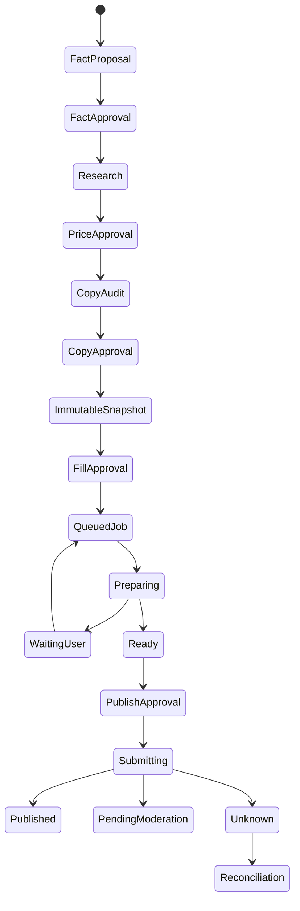

# Architecture

The application separates proposal, authority, evidence and execution.

| Layer | Responsibility |
|---|---|
| `channels` | Telegram identity boundary, previews and user decisions |
| `workflow` | Explicit order, interrupts and checkpoint-safe replay |
| `domain` | Validated models, price policy, snapshots, approvals and jobs |
| `models` | Local role routing, structured responses and metadata telemetry |
| `research` | Untrusted discovery, portal extraction, DNS/URL safety and evidence |
| `execution` | Transactional jobs, browser preparation, intervention and reconciliation |
| `browser` | Exact semantic locators, bounded repair actions and readback |
| `monitoring` | Local reports generated from an allow-list of operational metadata |
| `evaluation` | Versioned golden tests and reproducible environment metadata |
| `mcp_server` | Local stdio tools over the same domain contract |

LangGraph checkpoints represent process position. SQLite domain tables represent current
facts and authority. Models are stateless between calls; the application assembles a
narrow context from approved facts and bounded preferences. Raw conversation history is
not treated as memory or factual evidence.

The browser worker loads only a `job_id`, then reloads the immutable snapshot and
approval from SQLite. A local idempotency key prevents duplicate jobs. Because external
marketplaces do not accept this key, post-submit exactly-once semantics cannot be
guaranteed; uncertain outcomes enter reconciliation without automatic resubmission.

For OLX, the target architecture prefers the official Partner API once application
access is approved. It should implement the same snapshot and approval contract behind a
different execution adapter. The browser adapter remains the current controlled
prototype. Allegro Lokalnie stays browser-based because its official help excludes API
publication for that product.

See [the implementation walkthrough](WALKTHROUGH.md) and [ADRs](adr/) for detailed
decisions and alternatives.
