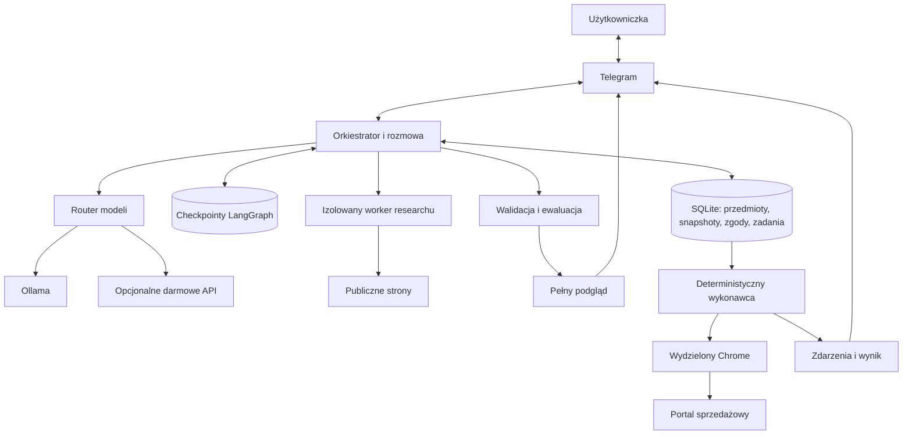

# Marketplace Listing Agent — wykonawczy plan rozwoju

> Dokument wewnętrzny dla kolejnego modelu lub implementera. Status obecnej wersji
> znajduje się w `PROJECT_STATUS_2026-09-13.md`. Każde stwierdzenie „wdrożone” wymaga
> kodu, testu i dowodu działania.

## 1. Cel produktu

Docelowy przebieg:

1. Użytkowniczka tworzy przedmiot w prywatnym Telegramie.
2. Wysyła zdjęcia i zwykłą notatkę o stanie.
3. System proponuje fakty i zadaje wyłącznie pytania potrzebne do identyfikacji,
   wyceny lub uczciwego opisu.
4. Użytkowniczka zatwierdza albo poprawia fakty.
5. Research zbiera i kwalifikuje rzeczywiste oferty.
6. Kod oblicza statystyki, pokazując próbę, źródła i ograniczenia.
7. Użytkowniczka wybiera cenę.
8. Model przygotowuje tekst, a reguły i audytor sprawdzają jego zgodność z faktami.
9. Telegram pokazuje pełny, niezmienny podgląd konkretnej wersji.
10. `wystaw` lub przycisk zatwierdza dokładnie ten snapshot i portal.
11. Ograniczony wykonawca korzysta z wydzielonej, trwałej sesji sprzedażowej.
12. Przy CAPTCHA lub wygasłym logowaniu zadanie pauzuje i prosi o interwencję.
13. Po `Kontynuuj` wykonawca ponownie odczytuje stronę i bezpiecznie wznawia pracę.
14. Po publikacji system zwraca zweryfikowany link lub jawny stan nierozstrzygnięty.

System ma być użyteczny na Macu z 24 GB RAM oraz stanowić weryfikowalny projekt do
rozmów o stanowisko AI Engineer.

## 2. Ustalenia, których implementer nie powinien zmieniać bez rozmowy

- Telegram jest pierwszym kanałem.
- OLX jest pierwszym portalem wykonawczym, Allegro Lokalnie drugim.
- Vinted pozostaje wyłączony z wykonania do osobnej weryfikacji zasad i testów.
- Główne profile: Nintendo Switch, gry Switch, Fujifilm X i elektronika Apple.
- Użytkowniczka chce wygodny, trwały profil sprzedażowy zamiast logowania przed każdą
  ofertą.
- Hasła, kody 2FA, cookies i dane kart nie przechodzą przez Telegram, model ani MCP.
- Model nie dostaje ogólnego narzędzia Playwright ani prawa do publikacji.
- Publikacja jest deterministyczną operacją na zaakceptowanym snapshotcie.
- CAPTCHA nie jest obchodzona. Powoduje kontrolowaną pauzę i wznowienie przez człowieka.
- Modele lokalne są domyślne. Dopuszczalne jest wyłącznie darmowe API z twardą blokadą
  naliczenia kosztów.
- Role mogą być wyspecjalizowane bez tworzenia autonomicznej „armii agentów”. Ten sam
  model może obsługiwać kilka ról, jeśli wygrywa w pomiarach.
- MCP i Docker są wdrażane po ustabilizowaniu kontraktów wewnętrznych.
- Fine-tuning jest mierzalnym eksperymentem po zbudowaniu niezależnej ewaluacji.
- Kurs powstaje równolegle z kodem i tłumaczy decyzje, alternatywy oraz awarie.
- Publiczne dokumenty mają być po angielsku. Ten polski plik jest notatką wewnętrzną.
- Nie pushować ani nie publikować kodu lub ofert bez osobnej autoryzacji.

## 3. Docelowe granice systemu

Zasady:

- niezaufana treść nie może tworzyć uprawnień;
- model proponuje dane, zaufany kod egzekwuje politykę;
- checkpoint wskazuje pozycję grafu, ale nie jest źródłem prawdy dla zgody;
- każda operacja zewnętrzna jest identyfikowalna i odporna na powtórzenie;
- niejednoznaczny dowód prowadzi do kwarantanny lub pauzy;
- każdy etap można wyjaśnić bez nazwy biblioteki, a następnie wskazać implementację.

## 4. Docelowe kontrakty danych

Nazwy są roboczym kontraktem. Implementer może dopasować je do stylu repozytorium,
ale nie może usunąć wymaganej semantyki.

### `FactRecord`

- `fact_id`, `item_id`, `name`, `value`;
- `source_kind`: user, image, model, derived;
- `source_ref`: identyfikator zdjęcia lub fragmentu notatki;
- `approval_status`: proposed, approved, rejected, superseded;
- wersja i czas.

Modelowy `confidence` przechowywać jako deklarację modelu, nie jako skalibrowane
prawdopodobieństwo.

### `ResearchEvidence`

- kanoniczny identyfikator źródła i URL;
- portal, tytuł, status, czas odczytu;
- kwota, waluta i typ kwoty: item, delivery, installment, previous, unknown;
- pola tożsamości produktu i wariantu;
- `verification_status`, `integrity_status`, `rejection_codes`;
- wskazanie kanału dowodu: DOM, JSON-LD, metadata;
- hash oczyszczonego dowodu lub zrzutu, jeśli zostaje zapisany.

### `ListingSnapshot`

- `snapshot_id`, `item_id`, `version`, `portal`;
- tytuł, opis, cena, kategoria, atrybuty i ustawienia dostawy;
- uporządkowane zdjęcia wraz z hashami zawartości;
- wersje faktów, researchu, promptów i konfiguracji;
- data utworzenia i status niezmienności.

Snapshot po utworzeniu nie jest edytowany. Zmiana tworzy nową wersję.

### `ApprovalRecord`

- `approval_id`, losowy token callback, `chat_id`/user;
- `item_id`, `snapshot_id`, portal i operacja;
- czas utworzenia, wygaśnięcia i jednorazowego użycia;
- status: pending, consumed, expired, revoked.

Domyślna ważność niewykorzystanej zgody: 24 godziny. Zgoda wygasa natychmiast po
zmianie snapshotu.

### `ExecutionJob`

- `job_id`, `snapshot_id`, `approval_id`, portal;
- stan: queued, preparing, ready, waiting_user, submitting, published,
  pending_moderation, failed, unknown, cancelled;
- numer próby, blokada właściciela, timestamps;
- idempotency key aplikacji;
- wynik, link, identyfikator portalu i dowody readback.

### `InterventionRequest`

- `intervention_id`, `job_id`, typ problemu;
- instrukcja dla użytkowniczki;
- stan strony i etap wznowienia;
- status: open, resumed, resolved, expired.

### `RunEvent`

- `run_id`, `item_id`, opcjonalnie `job_id`;
- komponent, operacja, start/koniec, wynik;
- model/provider/prompt/config/dataset versions;
- czas, tokeny, retry, fallback i przyczyna błędu;
- bez sekretów i pełnych prywatnych payloadów.

## 5. Niezmienniki bezpieczeństwa i poprawności

1. Do ceny wchodzi wyłącznie rekord dopuszczony przez jedną wspólną bramkę.
2. `suspicious` i `unchecked` nigdy nie wpływają na statystyki, także po timeout.
3. Nieznana lub obca waluta nie jest automatycznie PLN.
4. Cena dostawy, rata i cena przekreślona nie są ceną przedmiotu.
5. Model nie tworzy zgody, tokenu, wersji ani statusu publikacji.
6. Wykonawca pobiera snapshot po ID; nie przyjmuje nowego tekstu lub ceny w wywołaniu.
7. Każda zmiana tekstu, ceny, zdjęć, kategorii lub ustawień unieważnia zgodę.
8. Stary, powtórzony lub należący do innego kroku callback jest odrzucany.
9. Przed publikacją readback musi odpowiadać snapshotowi.
10. Nieoczekiwana opłata, promocja lub zgoda marketingowa zatrzymuje wykonanie.
11. Timeout po kliknięciu publikacji daje `unknown`, nie automatyczne ponowienie.
12. Hasła, OTP, cookies, tokeny i dane kart nie trafiają do Telegrama, modeli, MCP,
    logów i raportów.
13. Research nie ma dostępu do profilu sprzedażowego ani prywatnej sieci hosta.
14. CAPTCHA jest przekazywana człowiekowi, nie obchodzona.
15. Nie deklarować pełnej ochrony przed cloakingiem ani przejęciem całego Maca.

## 6. Etapy implementacji

### E0 — utrwalenie baseline i higiena repozytorium

Cel: kolejny etap ma zaczynać się od znanego, powtarzalnego stanu.

Zadania:

- zachować datowany raport stanu;
- dodać komendę generującą bezpieczny manifest: commit, wersje narzędzi, modele i
  konfiguracje bez sekretów;
- ustalić jeden kanoniczny checkout projektu;
- dodać walidację YAML oraz kompletności profili i źródeł;
- wyłączyć Vinted z wykonania; decyzję o pozostawieniu jako źródło researchu zapisać
  osobno po weryfikacji zasad;
- opisać cztery statusy dowodu: unit, integration, controlled browser, real portal.

Odbiór:

- manifest można wygenerować na czystym checkoutcie;
- dokumentacja nie przedstawia planów jako funkcji;
- użytkowniczka i kolejny model pracują w tej samej kopii repozytorium.

### E1 — poprawność researchu i ceny

Najpierw dodać test regresji dla każdego potwierdzonego błędu, potem poprawkę.

Zadania:

- przebudować ekstrakcję na portalowe obserwacje `PriceObservation`;
- rozpoznawać walutę i typ kwoty;
- porównywać DOM, JSON-LD i metadata dla tego samego ogłoszenia;
- dodać bezpieczne dopasowanie hosta przez dokładny host lub subdomenę;
- wprowadzić `is_pricing_eligible(evidence) -> decision + reason_codes`;
- użyć tej bramki we wszystkich ścieżkach, również timeout;
- rozdzielić aktywne ceny ofertowe od jawnie zakończonych ofert;
- dodać deduplikację po identyfikatorze ogłoszenia i kanonicznym URL;
- wyegzekwować `minimum_comparables`: poniżej progu pokazać obserwacje i brak
  wiarygodnej rekomendacji;
- zapisywać trwały, zredagowany manifest dowodów i przyczyn odrzucenia;
- dodać portalowe fixtures DOM bez korzystania z kont.

Testy obowiązkowe:

- dostawa przed ceną przedmiotu;
- PLN/USD/EUR/brak waluty;
- rozbieżność 100/1200;
- kwarantanna nadal oznaczona `comparable=True`;
- timeout z `unchecked`;
- duplikaty, rata, cena poprzednia, zakres cen i brak ceny;
- Switch/OLED/Lite, warianty Fuji oraz edycje gier;
- oferta aktywna kontra sprzedana.

Odbiór:

- żaden rekord niespełniający niezmienników nie wpływa na statystykę;
- wynik zawsze pokazuje liczebność, źródła, czas, wykluczenia i znaczenie cen;
- brak danych nie uruchamia zgadywania LLM.

### E2 — formularze bez publikacji i wiarygodne statusy

Zadania:

- serializować brakujące pola i zdjęcia do bezpiecznego DTO przed wywołaniem modelu;
- usunąć szerokie, ciche `except Exception`; rejestrować klasę i etap błędu;
- zastąpić substringowe reguły kliknięć enumeracją dozwolonych celów adaptera;
- dla czynności modelowych wymagać jednoznacznego, istniejącego elementu;
- rozszerzyć readback na kategorię, atrybuty, typ sprzedaży, dostawę i liczbę/hash
  zdjęć, w zakresie możliwym dla portalu;
- agregować wyniki portali: `ready`, `needs_user`, `failed`;
- nie ustawiać `READY_TO_PUBLISH`, jeśli choć jeden zatwierdzony portal nie jest gotowy;
- zapisywać screenshot i zredagowany raport formularza według polityki retencji;
- przygotować kontrolowaną lokalną stronę formularza do testów zmiany DOM.

Odbiór:

- znany błąd `Path` jest pokryty i naprawiony;
- status przedmiotu wynika z wyników wszystkich wybranych portali;
- nieznana kontrolka nie powoduje improwizowanego kliknięcia;
- żadne testy formularza nie mogą uruchomić realnej publikacji.

### E3 — paczkowanie, diagnostyka i czysta instalacja

Zadania:

- umieścić domyślne YAML jako zasoby pakietu albo wygenerować je jawnie do katalogu
  aplikacji przy inicjalizacji;
- przenieść dane użytkowniczki poza checkout do wersjonowanego katalogu aplikacji;
- pozwolić nadpisać ścieżki przez konfigurację;
- dodać test instalacji wheel w pustym virtualenv;
- rozszerzyć `doctor` o: wersję Pythona, zapis katalogów, połączenie z Ollamą,
  minimalne wywołanie testowe, Chrome, konfigurację Telegrama, integralność/migracje DB
  i blokadę profilu;
- zwracać kod niezerowy, jeśli wymagany element nie działa;
- oddzielić `doctor --core`, `--telegram`, `--models` i `--browser`, żeby diagnoza była
  precyzyjna;
- poprawić LaunchAgent tak, aby nie zależał od przypadkowej `.venv` w checkoutcie;
- dodać instrukcję zatrzymania i odinstalowania LaunchAgenta.

Odbiór:

- wheel działa z katalogu niezwiązanego z repo;
- `doctor` można użyć w CI/skrypcie na podstawie kodu wyjścia;
- czysta instalacja nie zapisuje danych prywatnych do repo.

### E4 — GitHub Actions i kontrola jakości

Zadania:

- dodać workflow na push i pull request;
- uruchamiać Ruff, unit/integration tests bez kont, budowę wheel i czystą instalację;
- dodać kontrolę schematu JSONL i unikalności ID;
- dodać testy bezpieczeństwa i skan sekretów;
- dodać audyt zależności oraz cykliczny PR aktualizacyjny dopiero po ustaleniu polityki;
- nadać workflow minimalne uprawnienia;
- nie przekazywać sekretów do kodu z niezaufanego PR;
- nie uruchamiać modeli, zalogowanego Chrome ani publikacji w zwykłym CI;
- dodać status badge dopiero po przejściu workflow na zdalnym GitHubie.

Odbiór:

- CI przechodzi na czystym runnerze;
- celowo zepsuty test blokuje PR;
- README wyjaśnia, że zielone CI nie potwierdza jakości modelu ani portalu.

### E5 — trwała rozmowa i wersjonowane akceptacje

Zadania:

- przenieść notatki i oczekujące kroki z `chat_data` do SQLite;
- wprowadzić snapshot i hashe zdjęć;
- dodać tabele migracji, snapshotów, akceptacji i zdarzeń rozmowy;
- generować krótki losowy callback, a pełny rekord trzymać w DB;
- atomowo sprawdzać i zużywać zgodę wraz z utworzeniem zadania;
- odrzucać stary callback, ponowne kliknięcie i innego użytkownika;
- zbudować pełny mobilny podgląd dla każdego portalu;
- obsłużyć naturalne poprawki i `nie wiem`;
- maksymalnie grupować trzy powiązane pytania;
- określić zależności: zmiana wariantu unieważnia research; zmiana ceny lub tekstu
  unieważnia snapshot i zgodę;
- po restarcie odtwarzać aktywny przedmiot, oczekujący krok i podgląd.

Odbiór:

- restart na każdym `interrupt` zachowuje właściwy krok;
- stary i podwójny przycisk są odrzucane;
- zmiana zawartości zdjęcia po akceptacji jest wykryta;
- użytkowniczka nie musi używać JSON do zwykłego opisu przedmiotu.

### E6 — monitoring i ewaluacja

Zadania:

- wprowadzić `run_id` i ustrukturyzowane lokalne zdarzenia;
- zapisywać model/provider/ID, prompt version, czasy, tokeny, retry i fallback;
- redagować treść przed logowaniem, a nie dopiero przed eksportem;
- przygotować lokalny raport HTML przebiegu;
- opcjonalnie dodać eksport zredagowanych śladów do LangSmith;
- eksport zewnętrzny ma być wyłączony domyślnie i nie może blokować procesu;
- dodać monitoring udziału błędów schematu, fallbacków, kwarantanny, czasu i liczby
  interwencji;
- raport ewaluacji uzupełnić o commit, hash datasetu/promptu, model ID i sprzęt;
- przy benchmarku konkretnego modelu wyłączyć fallback;
- rozróżnić błąd transportu, limitu, schematu i jakości.

Golden dataset — etap pierwszy:

- minimum 120 przypadków: po 20 dla faktów, porównywalności, copy, copy audit,
  formularzy i ceny;
- osobne oznaczenie danych syntetycznych i rzeczywistych;
- fakty z prawdziwymi obrazami i poprawnością wartości, nie tylko nazw pól;
- trudne przykłady wad, niepewności, injection i bliskich wariantów;
- podział według grup przedmiotów, aby parafrazy nie przeciekały między zbiory;
- zamrożony test niezależny od strojenia promptu.

Później rozszerzyć do około 300 przypadków oraz osobnej macierzy bezpieczeństwa.
Liczebność nie jest celem samym w sobie; każdy przykład musi mieć uzasadnienie etykiety.

Odbiór:

- z pojedynczego `run_id` można odtworzyć źródła faktów, cenę, model, walidacje,
  poprawki i wynik;
- dashboard nie zawiera sekretów;
- raport podaje liczebność i ograniczenia, bez jednej „magicznej” oceny.

### E7 — wykonawca i interwencje człowieka

Zadania:

- wydzielić wykonawcę jako osobny proces z wąskim kontraktem `job_id`;
- zachować jeden trwały profil Chrome bez synchronizacji osobistego Chrome;
- zapewnić pojedynczego właściciela profilu i blokadę konkurencyjnego procesu;
- implementować jawny adapter portalowy, bez dowolnego sterowania przez model;
- dodać wykrywanie CAPTCHA, wygasłego logowania, nieznanego pola i opłaty;
- zapisywać `InterventionRequest`, pauzować tylko dane zadanie i powiadamiać raz;
- po `Kontynuuj` sprawdzić, czy przeszkoda zniknęła, wykonać readback i kontynuować;
- jeśli strona wygasła, odtworzyć formularz z zatwierdzonego snapshotu;
- wprowadzić watchdog aktywnej pracy, lecz nie przedstawiać go jako unieważnienia
  sesji portalu;
- dodać awaryjne zatrzymanie kolejki.

Odbiór:

- CAPTCHA pozostawia formularz otwarty, a reszta bota działa;
- `Kontynuuj` przy nadal istniejącej przeszkodzie nie wykonuje kolejnych akcji;
- ręczna zmiana pola jest wykryta i wymaga nowego snapshotu;
- hasło i 2FA są wpisywane bezpośrednio na stronie przez użytkowniczkę.

### E8 — Docker i izolacja researchu

Krok 1: kontener testów i demonstracji.

- obraz ARM64, zależności z lockfile, użytkownik nieuprzywilejowany;
- brak sekretów i prywatnych danych w obrazie;
- read-only root tam, gdzie praktyczne;
- kontrolowane wolumeny i limity zasobów.

Krok 2: worker researchu.

- własny Chromium;
- brak montowania katalogu domowego, Keychain, profilu sprzedaży, bazy zgód i socketu
  Dockera;
- wąski lokalny interfejs przyjmujący zapytanie i zwracający dowody;
- wyjście do internetu przez proxy sprawdzający rzeczywisty adres każdego połączenia;
- blokada prywatnych, loopback i link-local IPv4/IPv6, redirectów i dostępu do hosta;
- testy negatywne potwierdzające granice.

Ollama i sprzedażowy Chrome pozostają początkowo na Macu. Kontener nie jest celem
estetycznym; ma zapewnić powtarzalność albo rzeczywistą granicę uprawnień.

Odbiór:

- research nie może odczytać kontrolnego pliku hosta ani połączyć się z kontrolną
  usługą prywatną;
- wszystkie wymagane publiczne portale nadal działają przez ograniczony egress;
- dokumentacja uczciwie opisuje granice izolacji Docker Desktop na macOS.

### E9 — publikacja OLX i uzgadnianie wyniku

Przed implementacją ponownie sprawdzić aktualny regulamin, opłaty, formularz i
dostępność zaakceptowanego API. Projekt może zachować browser-first, ale oficjalne API
OLX jest wartą porównania alternatywą, jeśli aplikacja otrzyma dostęp.

Zadania:

- dodać operację publikacji wyłącznie po poprawnym readback;
- przed kliknięciem zapisać próbę i lokalny idempotency key;
- blokować nieoczekiwane opłaty i promocje;
- po kliknięciu pozyskać identyfikator/link lub stan moderacji;
- zaimplementować reconciliation przez panel ofert;
- po utracie odpowiedzi ustawiać `unknown`, bez automatycznego retry;
- przy ponowieniu najpierw sprawdzić, czy oferta już istnieje;
- zwrócić użytkowniczce link, status i ostrzeżenia.

Odbiór:

- pełny test kontrolowany nie może opublikować przypadkowej oferty;
- rzeczywisty test publikacji następuje tylko dla dokładnie zatwierdzonego przedmiotu;
- utrata sieci po submit nie tworzy automatycznie duplikatu;
- nie obiecywać semantyki exactly-once, której portal nie zapewnia.

### E10 — MCP nad gotowym kontraktem

Pierwszy serwer MCP uruchamiać lokalnie przez `stdio`.

Narzędzia odczytowe:

- `get_item_status(item_id)`;
- `get_approved_snapshot(snapshot_id)`;
- `get_pricing_evidence_summary(item_id)`.

Narzędzia wykonawcze dopiero po E9:

- `execute_approved_listing(job_id)`;
- `get_execution_status(job_id)`;
- `resume_execution(job_id, intervention_id)`;
- `cancel_execution(job_id)`.

Reguły:

- MCP nie przyjmuje hasła, OTP, cookie, nowej ceny ani nowego opisu;
- serwer ponownie ładuje snapshot i zgodę z bazy;
- model researchowy i copywriter nie otrzymują narzędzia publikacji;
- nie wystawiać publicznego HTTP;
- każde wywołanie ma audit event i jawny błąd domenowy;
- testować brak zgody, obcą wersję, powtórzenie i niedozwolony tool.

Odbiór:

- MCP daje drugi interfejs do tej samej sprawdzonej logiki;
- odłączenie MCP nie psuje podstawowego przepływu;
- dokumentacja wyjaśnia, że MCP jest protokołem, a nie automatyczną sandboxą.

### E11 — Allegro Lokalnie i dalsze portale

Oficjalna pomoc Allegro mówi obecnie, że API dotyczy Allegro, nie Allegro Lokalnie.
Dlatego ten adapter wymaga browser execution i osobnego przeglądu zasad.

Zadania:

- zbudować osobny adapter, fixtures i mapę pól;
- obsłużyć typ ogłoszenia, dostawę, opłaty i promocje;
- przeprowadzić pełny controlled-browser test;
- dopiero potem wykonać pojedynczy zatwierdzony test rzeczywisty;
- Vinted pozostawić poza wykonaniem do nowej, jawnej decyzji.

Nie abstrahować portalowych różnic za wcześnie. Wspólny kontrakt dotyczy zadania i
wyniku, natomiast selektory, opłaty i stany pozostają odpowiedzialnością adaptera.

### E12 — LoRA jako eksperyment

Hipoteza:

> LoRA małego modelu do mapowania zatwierdzonych faktów na polski opis zmniejszy
> niepoparte twierdzenia i pominięcia wad względem mocnego promptu.

Zakres:

- tylko generowanie tekstu;
- bez uczenia narzędzi, publikacji, logowania lub danych uwierzytelniających;
- baseline: deterministyczny szablon, model z promptem, model z LoRA;
- lokalny model około 1–4B zgodny z MLX-LM, wybrany po pilotażu pamięci;
- około 300 zweryfikowanych par treningowych jako punkt startowy;
- osobne train/validation/frozen test, bez bliskich duplikatów;
- zapisana proweniencja, licencja, seed, parametry, bazowy model i adapter;
- metryki: factuality, preservation of defects, completeness, Polish quality, czas,
  pamięć i rozmiar adaptera.

Modelowo wygenerowane przykłady wymagają kontroli względem dowodów. Integracja nastąpi
tylko przy istotnej poprawie na zamrożonym teście. Negatywny wynik również jest dobrym
rezultatem badawczym, jeśli eksperyment jest powtarzalny.

## 7. Przebudowa kursu

### Standard każdej lekcji

1. Problem użytkowy i potrzebna teoria.
2. Konkretny przykład z tego projektu.
3. Stan danych przed i po kroku.
4. Diagram przepływu oraz granice zaufania.
5. Prowadzony przebieg poprawny.
6. Prowadzona awaria i diagnoza.
7. Alternatywy oraz powód decyzji.
8. Kilka ważnych fragmentów kodu z wyjaśnieniem składni.
9. Demonstracja lub test przygotowany przez asystenta.
10. Krótkie pytania rekrutacyjne i odpowiedzi z ograniczeniami.

Ćwiczenie nie zastępuje wykładu. Komentarze w kodzie tłumaczą powody i pułapki,
zamiast parafrazować linię.

### Program

| Moduł | Rezultat |
|---|---|
| 0. Pomysł i granice | Użytkowniczka wyjaśnia problem i zakres autonomii |
| 1. Mapa systemu | Rozróżnia proces, serwer, usługę, endpoint i adapter |
| 2. Jeden przedmiot | Śledzi zdjęcie i notatkę do wyniku |
| 3. Python projektu | Rozumie typy, Pydantic, wyjątki, `async` i zależności |
| 4. LangGraph | Rozumie state, node, edge, routing, interrupt i replay |
| 5. SQLite | Rozumie tabele, JSON, transakcje, migracje, checkpoint i backup |
| 6. Modele | Rozumie inferencję, kontekst, tokeny, obrazy i routing |
| 7. Walidacja | Rozróżnia poprawny JSON od prawdziwego twierdzenia |
| 8. Research | Rozumie HTTP, DNS, DOM, metadata i dowód ceny |
| 9. Bezpieczeństwo AI | Rozumie injection, SSRF, least privilege i fail closed |
| 10. Akceptacje | Rozumie snapshot, wersję, token i idempotency |
| 11. Browser automation | Rozumie sesję, cookie, formularz, CAPTCHA i readback |
| 12. Monitoring | Potrafi znaleźć przyczynę błędu w trace |
| 13. Ewaluacja | Rozumie goldeny, metryki, leakage i regresję |
| 14. Git i CI | Rozumie branch, commit, PR, konflikt, revert i Actions |
| 15. Eksploatacja | Potrafi zdiagnozować, zatrzymać, zbackupować i odtworzyć |
| 16. Docker | Rozumie obraz, kontener, wolumen, sieć i sandbox |
| 17. MCP | Rozumie host, client, server, tool i autoryzację |
| 18. Fine-tuning | Rozumie SFT, LoRA, overfitting i baseline |
| 19. Obrona projektu | Umie omówić decyzje, dowody i własny wkład |

### Artefakty nauki

- aktualna mapa komponentów;
- diagram grafu generowany lub weryfikowany względem kodu;
- diagramy sekwencji: sukces, edycja, CAPTCHA, restart, unknown submit;
- słownik pojęć;
- ADR dla ważnych decyzji;
- atlas prawdziwych awarii projektu;
- demonstracja offline;
- odpowiedzi rekrutacyjne w wersji 60 sekund, 5 minut i 15 minut;
- macierz: kompetencja → implementacja → dowód → poziom zrozumienia.

Każda zmiana architektoniczna jest ukończona dopiero, gdy ma kod, test, ADR lub zapis
decyzji, aktualny diagram, rozdział kursu i demonstrację sukcesu lub awarii.

## 8. Pakiet projektu do CV

### Co ma przyciągać uwagę

- jawny, trwały workflow z human-in-the-loop;
- evidence-based pricing zamiast „ceny wymyślonej przez LLM”;
- walidacja strukturalna, deterministyczna i semantyczna;
- bezpieczeństwo jako egzekwowalne bramki i testy;
- obserwowalność i niezależne evals;
- udokumentowane decyzje oraz świadome ograniczenia;
- opcjonalnie: wąski MCP i rzetelny eksperyment LoRA.

### Wymagane publiczne dowody

- prosty README po angielsku;
- aktualna architektura i threat model;
- CI oraz instrukcja powtarzalnego uruchomienia;
- oczyszczony raport ewaluacji z liczebnością;
- demo bez prywatnych danych;
- trzy case studies:
  1. naprawa błędnej wyceny;
  2. version-bound approval i ochrona przed duplikatem;
  3. wykrycie niepopartego twierdzenia w opisie;
- rejestr ograniczeń;
- raport LoRA, jeśli eksperyment faktycznie wykonano.

### Zasady formułowania CV

Rozróżniać:

- `designed/implemented` — istnieje kod;
- `tested/evaluated` — istnieje zdefiniowany test i wynik;
- `validated on a real portal` — wykonano rzeczywisty kontrolowany przebieg;
- `planned` — nie trafia jako gotowa kompetencja.

Nie pisać „wytrenowałam model”, jeśli wykonano tylko prompt engineering. Nie pisać
„produkcyjny agent”, dopóki nie ma realnego przepływu, recovery i monitoringu.

## 9. Scenariusze akceptacyjne całego produktu

1. Pełny przedmiot od zdjęć do zweryfikowanego wyniku.
2. Sprzeczność notatki i zdjęcia.
3. Zmiana Switch na Switch OLED po pierwszym researchu.
4. Brak wystarczającej liczby ofert.
5. Same oferty w kwarantannie.
6. Błąd modelu głównego i kontrolowany fallback.
7. Wyczerpanie darmowego API bez kosztu.
8. Restart na każdym punkcie akceptacji.
9. Stary, powtórzony i obcy callback.
10. Zmiana tekstu, ceny lub zdjęcia po podglądzie.
11. CAPTCHA i poprawne wznowienie.
12. `Kontynuuj`, gdy CAPTCHA nadal istnieje.
13. Ręczna zmiana formularza podczas interwencji.
14. Zmiana DOM i nieznana kontrolka.
15. Nieoczekiwana płatna opcja.
16. Utrata sieci przed i po submit.
17. Reconciliation znajdujące istniejącą ofertę.
18. Awaria lub blokada SQLite.
19. Backup i odtworzenie do innego katalogu.
20. Próba researchu do localhost, routera i link-local.
21. Próba odczytu profilu sprzedaży przez kontener researchu.
22. Wykonanie przez MCP bez poprawnej zgody.

Testy rzeczywistego publikowania wymagają osobnej, konkretnej zgody. Przypadki awarii
realizować głównie na lokalnych fixtures i atrapach portalu.

## 10. Sposób pracy kolejnego modelu

1. Zacznij od `PROJECT_STATUS_2026-09-13.md`, sprawdź `git status` i aktualny commit.
2. Zweryfikuj, czy `/Users/oliwia/Desktop/shopper-bot` nadal jest kanoniczną kopią.
3. Nie przepisuj całości. Utrzymaj warstwy i poprawiaj je etapami.
4. Przed każdym znanym błędem dodaj regresję, potem poprawkę.
5. Po zmianie uruchom najmniejszy trafny test, następnie pełny suite i Ruff.
6. Nie osłabiaj danych oczekiwanych tylko po to, aby model zaliczył test.
7. Nie powtarzaj udanego benchmarku bez zmiany hipotezy, danych, modelu lub promptu.
8. Po etapie zaktualizuj status, ADR, diagram i kurs.
9. Raportuj: co zmieniono, dlaczego, jak sprawdzono, jakie ryzyko zostało.
10. Oznacz niezweryfikowaną część jako otwartą zamiast dopowiadać sukces.
11. Przed aktualnym twierdzeniem o modelu, API lub zasadach portalu sprawdź oficjalne
    źródła z datą.
12. Nie pushuj, nie publikuje oferty i nie podłączaj konta bez odpowiedniej zgody.

## 11. Kolejność zależności

Realizować kolejno:

`E0 → E1 → E2 → E3 → E4 → E5 → E6 → E7 → E8 → E9 → E10 → E11 → E12`.

Przebudowa kursu i pakiet dowodów biegną przez wszystkie etapy. E10 MCP zależy od
gotowego kontraktu wykonawcy i publikacji. E12 LoRA zależy od E6, czyli wiarygodnej
ewaluacji. Allegro Lokalnie nie blokuje ukończenia dobrego pierwszego produktu OLX.

## 12. Źródła wymagające okresowej weryfikacji

- LangGraph interrupts i replay: https://docs.langchain.com/oss/python/langgraph/interrupts
- OWASP SSRF: https://cheatsheetseries.owasp.org/cheatsheets/Server_Side_Request_Forgery_Prevention_Cheat_Sheet.html
- MCP security: https://modelcontextprotocol.io/docs/2025-11-25/tutorials/security/security_best_practices
- SQLite backup: https://sqlite.org/backup.html
- GitHub Actions dla Pythona: https://docs.github.com/en/actions/tutorials/build-and-test-code/python
- LangSmith observability: https://docs.langchain.com/langsmith/observability-concepts
- OLX Developer Portal: https://developer.olx.pl/
- Allegro Lokalnie — publikowanie i API: https://allegro.pl/pomoc/dla-kupujacych/sprzedaz-na-allegro-lokalnie/jak-wystawic-ogloszenie-na-allegro-lokalnie-XEB1GldM8HR
- MLX-LM: https://github.com/ml-explore/mlx-lm
- PEFT/LoRA: https://huggingface.co/docs/peft/main/conceptual_guides/lora
