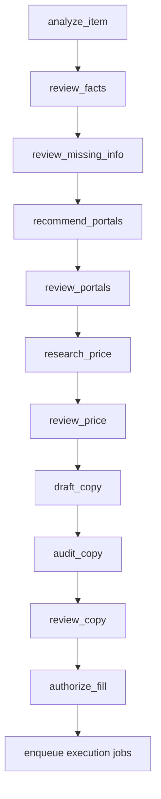

# Walkthrough implementacji od wejścia do publikacji

## 1. Uruchomienie i konfiguracja

1. `marketplace_agent.cli:_settings` tworzy `Settings`.
2. `Settings.ensure_directories` zakłada prywatny katalog aplikacji i instaluje
   domyślne YAML/goldens przy pierwszym uruchomieniu.
3. `ApplicationRuntime` otwiera repozytorium domenowe, router modeli, manager sesji i
   checkpointer LangGraph.
4. `TelegramChannel` sprawdza allowlistę jednego `chat_id` przed każdą komendą.

## 2. Ingest i zachowanie kontekstu

- `/nowa` tworzy `ItemCase` i trwałe powiązanie kanału z przedmiotem.
- Zdjęcia trafiają do `data/items/<item_id>/photos`; w zdarzeniu zapisuje się tylko
  nazwa pliku.
- Notatki trafiają do `conversation_notes`; restart procesu ich nie usuwa.
- Model nie ma własnej trwałej pamięci. Każdy prompt składa aplikacja z zatwierdzonych
  faktów, aktualnego kroku i ograniczonego zestawu preferencji.

## 3. Graf

Każdy `review_*` używa interrupt. Fakty oznaczone jako bezpośrednio podane przez
użytkowniczkę są akceptowane bez osobnego klikania. Pytanie pojawia się tylko przy
sprzeczności lub braku rozpoznania rodzaju przedmiotu, najwyżej trzy naraz. Zwykłe
zdanie oraz „nie wiem” są prawidłowymi odpowiedziami.

## 4. Research i opis

`MarketResearchService` tworzy plan wyszukiwania, zbiera kandydatów i przepuszcza każdy
rekord przez jedną bramkę cenową. `evidence.py` zapisuje zredagowany manifest.
`draft_copy` buduje `CopyBrief` z dwóch jawnych zakresów: faktów o egzemplarzu i
źródłowych specyfikacji modelu. Copywriter zwraca tylko tytuł oraz opis; pola formularza
składa kod. Kategoria trafia do briefu jako dowód językowy, ale jej wartość w formularzu
nadal ustala kod. `audit_copy` łączy kontrolę wymaganych faktów i znanych twierdzeń ryzykownych
z audytem claim-level, wykonuje najwyżej jedną naprawę i przy dalszym błędzie używa
bezpiecznego szablonu. Cały pipeline ma wspólny deadline pięciu minut.

Brief, wersje tekstu, audyty i ostrzeżenia są lokalnie przechowywane przez 30 dni.
`copy-report` pokazuje przepływ i hash każdej wersji, a `copy-rate` wiąże ocenę człowieka
z tym hashem. Materiał teoretyczny i protokół eksperymentu opisuje
[`course/11_WIARYGODNY_OPIS_OFERTY.md`](course/11_WIARYGODNY_OPIS_OFERTY.md).

## 5. Snapshot i zgoda

`CatalogRepository.create_listing_snapshot` hashuje kanoniczny JSON i bajty zdjęć.
Identyczny payload zwraca to samo ID; zmiana tworzy kolejną wersję i unieważnia pending
approvals. Telegram pokazuje wszystkie pola, wersję i skróty hashy. Token jest losowy,
jednorazowy, ważny 24 godziny i związany z kanałem, przedmiotem oraz krokiem.

## 6. Worker

`ExecutionEngine.run_once` atomowo przejmuje jedno zadanie. `BrowserExecutionAdapter`
ponownie sprawdza hashe zdjęć, wypełnia pola i robi readback. Login, CAPTCHA, opłata,
nieznana kontrolka lub różnica tworzą `InterventionRequest`. `resume-job` nie zakłada,
że problem zniknął; worker wykonuje wszystkie kontrole ponownie.

## 7. Publikacja

Status `ready` oznacza potwierdzone wypełnienie, nie publikację. `/wystaw JOB_ID` pokazuje
osobny końcowy podgląd. Po jego akceptacji job dostaje `authorized_to_publish`. Worker
ponownie wykonuje readback i szuka dokładnie jednego dozwolonego przycisku. Flaga
`MARKETPLACE_AGENT_ALLOW_LIVE_SUBMIT` jest domyślnie `false`.

Po timeout nie ma retry. Status `unknown` wymaga `reconcile-job`, które tylko odczytuje
stronę. Realny controlled-browser inventory i jedna rzeczywista publikacja nadal są
osobnymi etapami operacyjnymi wymagającymi zalogowanej sesji oraz konkretnej zgody.

## 8. MCP

`marketplace-listing-agent-mcp` uruchamia MCP SDK v2 po `stdio`. `MCPFacade` ma mały
interfejs oparty na ID. Żadne narzędzie nie przyjmuje danych uwierzytelniających ani
nowego payloadu ogłoszenia. Worker pozostaje oddzielnym procesem.

## 9. Gdzie zacząć czytanie kodu

1. `domain/models.py` — język domeny.
2. `workflow/state.py` i `workflow/graph.py` — kolejność i decyzje.
3. `domain/catalog.py` — trwałość, transakcje, zgody i joby.
4. `research/security.py`, `pricing.py`, `evidence.py` — zaufanie do danych rynku.
5. `models/router.py` — specjalizacja modeli i telemetry.
6. `browser/forms.py` — ograniczone sterowanie formularzem i readback.
7. `execution/engine.py` — granica skutku zewnętrznego.
8. `mcp_server.py` — drugi interfejs do tej samej domeny.
9. `evaluation/runner.py` — sposób mierzenia zamiast deklarowania jakości.

Po każdym pliku warto znaleźć odpowiadający mu test. Test ujawnia kontrakt szybciej niż
czytanie implementacji linia po linii.
