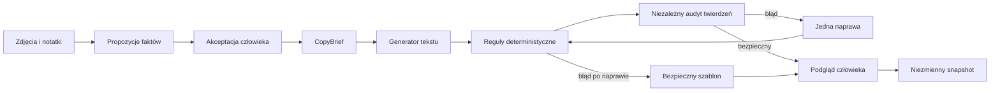

# Rozdział 11. Wiarygodny opis oferty jako system pomiarowy

## 1. Problem techniczny

Model językowy nie „zna przedmiotu”. Otrzymuje skończony kontekst i przewiduje kolejne
tokeny. Płynne zdanie może być fałszywe, ponieważ naturalność i zgodność z dowodem są
różnymi własnościami. Dlatego produkcyjny generator opisu powinien być traktowany jako
pipeline podejmowania ograniczonych decyzji, a nie pojedynczy prompt.

W projekcie jednostką prawdy jest `CopyClaim`. Ma klucz, wartość, zakres oraz informację
o źródle. `scope=item` opisuje konkretny egzemplarz: rysę, kolor, zawartość zestawu.
`scope=product_spec` opisuje model produktu: przekątną ekranu czy mocowanie obiektywu.
Drugie twierdzenie wymaga źródła producenta i nie dowodzi, że egzemplarz działa.

## 2. Przepływ danych



Kod kontroluje strukturę, wersje i skutki zewnętrzne. Model odpowiada za zadanie
rozmyte: język. Ten podział zmniejsza powierzchnię halucynacji. Gdyby model zwracał
także cenę i atrybuty formularza, jedna niepoparta liczba mogłaby zostać wykonana przez
browser worker.

## 3. Dlaczego dwa rodzaje walidacji

Reguła deterministyczna jest szybka, odtwarzalna i łatwa do wyjaśnienia. Dobrze wykrywa
znane klasy ryzyka, np. słowo „sprawny” bez testu egzemplarza. Nie rozumie jednak każdej
parafrazy. Audytor modelowy lepiej interpretuje znaczenie, ale sam może się mylić.
Połączenie obu metod daje defense in depth. Decyzja negatywna którejkolwiek warstwy
prowadzi do naprawy lub szablonu.

Audyt claim-level rozbija opis na twierdzenia i dla każdego podaje `supported`,
`contradicted`, `unsupported` albo `uncertain` wraz z kluczami dowodu. Dzięki temu
monitoring odpowiada na pytanie „co było niepoparte?”, a nie tylko „jaki był score?”.

## 4. Metryki, które coś znaczą

- **Required fact recall**: jaki odsetek faktów krytycznych zachowano w opisie.
- **Unsupported-claim rate**: ile twierdzeń nie ma podstawy w briefie.
- **Audit sensitivity**: jaki odsetek celowo zepsutych opisów audytor odrzuca.
- **Audit specificity**: jaki odsetek poprawnych opisów audytor przepuszcza.
- **Fallback rate**: jak często system nie ufa generatorowi i używa szablonu.
- **Latency p95**: czas, którego nie przekracza 95% przebiegów.
- **Ocena człowieka**: naturalność, jasność, zaufanie, portal fit i użyteczność.

Jedna średnia może ukryć krytyczny błąd. W tym projekcie halucynacja o sprawności jest
bramką: wariant odpada niezależnie od stylu. Dopiero bezpieczne warianty porównuje się
językowo.

## 5. Projekt eksperymentu

Podział po rodzinie produktu zapobiega leakage: bardzo podobny Nintendo Switch nie może
jednocześnie uczyć promptu i udawać niezależnego testu. `development` służy do naprawy
pipeline'u, `selection` do wyboru modelu i parametrów, a `frozen` do jednokrotnego
sprawdzenia wybranego wariantu.

Każdy eksperyment zapisuje model, parametry losowania, hash danych, hash konfiguracji,
commit i czasy. Powtórzenia pokazują wariancję. Ślepa ocena człowieka używa hashy
wariantów, aby nazwa modelu nie wpływała na werdykt.

Przykładowe polecenie:

```bash
marketplace-listing-agent eval \
  --suite copy_quality \
  --model qwen3.5:9b \
  --split selection --limit 10 --repeats 3 \
  --temperature 0.2 --top-p 0.9 --top-k 20 --seed 42
```

Po wygenerowaniu prawdziwego przebiegu:

```bash
marketplace-listing-agent copy-report --run-id RUN_ID
marketplace-listing-agent copy-rate --run-id RUN_ID --item-id ITEM_ID \
  --portal olx --variant-hash HASH --naturalness 4 --clarity 5 \
  --factual-trust 5 --portal-fit 4 --usefulness 4
```

## 6. Kiedy LoRA ma sens

LoRA zmienia zachowanie modelu przez uczenie małej liczby dodatkowych parametrów.
Może utrwalić styl, strukturę albo domenowe mapowanie. Nie tworzy prawdy o egzemplarzu
i nie zastępuje retrievalu, akceptacji faktów ani audytu.

Decyzja o treningu jest uzasadniona, gdy na realnym zbiorze istnieje stabilna klasa
błędu, prompting i szablon jej nie rozwiązują, a adapter poprawia wynik na zamrożonym
teście. Jeżeli szablon osiąga ten sam wynik, LoRA zwiększa koszt utrzymania bez korzyści
produktowej. Może pozostać wartościowym eksperymentem portfolio, ale trzeba tak ją
uczciwie opisać.

## 7. Pytania kontrolne do rozmowy

1. Dlaczego model generuje tylko tekst, a pola formularza składa kod?
2. Czym różni się fakt o modelu produktu od faktu o egzemplarzu?
3. Kiedy reguła deterministyczna jest lepsza od LLM-as-a-judge?
4. Dlaczego 6/6 na syntetycznym pilocie nie dowodzi jakości produkcyjnej?
5. Jak hash wariantu i split po rodzinie zwiększają wiarygodność eksperymentu?
6. Jakie dane musiałyby uzasadnić wdrożenie LoRA?
