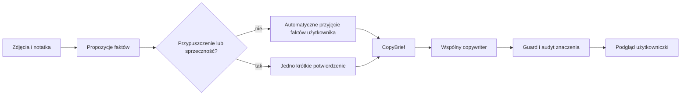

# Rozdział 12. Generalizacja opisu i LoRA v2

## 1. Problem użytkowy

Użytkowniczka nie chce wypełniać technicznego kwestionariusza dla każdej lokówki,
słuchawek czy ekspresu. Chce przekazać zdjęcia oraz zwykłą notatkę, a następnie dostać
tekst do sprawdzenia. Architektura ma więc chronić znaczenie danych, a nie wymuszać ich
kompletność.

Rozważmy notatkę:

> Lokówka Remington, używana kilka razy, włącza się, bez pudełka.

Poprawny system może napisać, że użytkowniczka deklaruje włączanie urządzenia. Nie ma
podstawy, by twierdzić, że regulacja temperatury działa, lokówka szybko się nagrzewa
albo jest w pełni sprawna. Brak takich danych nie powinien jednak uruchamiać ankiety.

## 2. Przepływ danych po uproszczeniu

Profil kategorii nie dokleja już listy pytań. Pozostaje użyteczny przy porównywaniu
cen i mapowaniu pól formularza. To rozdzielenie odpowiedzialności: identyfikacja
wariantu jest ważna dla ceny, lecz nie jest warunkiem napisania krótkiego opisu.

## 3. Dlaczego kategoria musi trafić do modelu

W pierwszym screeningu kod deterministycznie ustawiał kategorię formularza, ale usuwał
ją z `CopyBrief`. Model zobaczył markę Remington i kod CI9532, a następnie nazwał
lokówkę maszynką do golenia. Typ i model przedmiotu pełnią dwie role:

- kod używa kategorii do formularza;
- copywriter potrzebuje jej jako dowodu językowego.

Po dodaniu kategorii do briefu copywriter poprawnie pisał „lokówka Remington CI9532”.
To przykład błędu kontekstu: model nie musi być słaby; aplikacja mogła nie przekazać mu
informacji potrzebnej do zadania.

## 4. Minimalna kontrola wierności

Walidacja odpowiada na trzy pytania:

1. Czy tekst dopisał twierdzenie?
2. Czy zmienił zakres twierdzenia?
3. Czy pominął wadę, brak lub istotną cechę podaną przez użytkowniczkę?

Pydantic sprawdza strukturę, np. czy odpowiedź zawiera portal, tytuł i opis. Nie
sprawdza prawdziwości zdania. Reguły deterministyczne dobrze wykrywają znane błędy,
lecz nie mają ogólnego rozumienia języka. W screeningu model dopisał funkcje ekspresu,
których nie było w briefie; prosty słownik nie wykrył tej nowej klasy twierdzenia.
Dlatego audyt znaczenia i podgląd człowieka pozostają potrzebne.

## 5. Co oznacza generalizacja

Generalizacja oznacza działanie na przykładach różniących się od treningowych. Losowy
podział pojedynczych rekordów może oszukiwać: niemal identyczna lokówka znajdzie się w
train i test. W nowym zbiorze jednostką podziału jest cała rodzina produktu.

Zestaw `copy_generalization` ma 120 przypadków z 12 rodzin. Development, selection i
frozen zawierają osobne rodziny. Frozen obejmuje routery, roboty kuchenne, suszarki i
elektronarzędzia. Obejrzenie jego błędów zużywa go jako finalny test; po strojeniu
trzeba przygotować nowy zbiór potwierdzający.

## 6. LoRA od strony mechanizmu

Dla warstwy liniowej z macierzą wag `W` pełny fine-tuning aktualizowałby wszystkie jej
elementy. LoRA zamraża `W` i uczy dwie mniejsze macierze:

\[
W' = W + sBA
\]

Jeżeli rank `r` jest mały, liczba trenowanych parametrów dla macierzy o wymiarach
`d_in × d_out` spada z `d_in × d_out` do około `r(d_in + d_out)`. Rank określa
pojemność aktualizacji, a skala `s` wpływa na siłę adaptera.

LoRA nie dodaje dowodów o sprzedawanym przedmiocie. Uczy wzorca przekształcenia wejścia
w tekst. Guard, audyt i zgoda człowieka są potrzebne również po treningu.

## 7. Eksperyment v2

Użyto 600 syntetycznych przykładów: 400 train, 100 validation i 100 frozen test.
Suszarki oraz wiertarko-wkrętarki nie występowały podczas optymalizacji. Porównano ten
sam model bazowy z adapterami rank 8 i 16.

Validation loss rank 16 spadł niżej niż rank 8. Gdyby decyzję podjąć tylko na tej
liczbie, wygrałby rank 16. Frozen test pokazał jednak, że oba adaptery zachowują
dokładną nazwę przedmiotu tylko w połowie przypadków i często sklejają słowa na granicy
czasownika oraz rzeczownika. Większy rank prawie nie pomógł.

Wniosek: loss odpowiada na pytanie, jak model przewiduje tokeny w danych validation.
Nie odpowiada samodzielnie na pytanie, czy opis jest poprawny, naturalny i wierny dla
nowej kategorii. Z tego powodu adaptery nie weszły do aplikacji.

## 8. Dwa walkthrough

### AirPods

Wejście: „AirPods Pro 2, używane kilka razy, włączają się”.

- ekstraktor zapisuje kategorię, markę, model, stan oraz dokładny zakres deklaracji;
- brak kondycji baterii i akcesoriów nie tworzy pytań;
- brief przekazuje tylko zatwierdzone dane;
- tytuł „AirPods Pro 2 — sprawne” zostaje odrzucony, bo rozszerza zakres testu;
- poprawny opis mówi jedynie, że użytkowniczka deklaruje włączanie urządzenia.

### Lokówka

Wejście: „Lokówka Remington CI9532, używana kilka razy, bez pudełka”.

- kategoria trafia do briefu, więc kod modelu nie jest jedyną wskazówką językową;
- system nie pyta o temperaturę ani przewód;
- „bez pudełka” musi pozostać brakiem, nie może zmienić się w „pudełko w zestawie”;
- podgląd pozwala poprawić dowolne sformułowanie przed utworzeniem snapshotu.

## 9. Jak obronić decyzję na rozmowie

> Początkowo profile kategorii automatycznie generowały wiele pytań. Test użytkowy
> pokazał, że zwiększa to koszt wystawienia prostego przedmiotu. Oddzieliłam więc
> kompletność danych potrzebnych do wyceny od danych potrzebnych do opisu. Generator
> działa na niepełnym briefie, a walidacja pilnuje zachowania podanych faktów. Zbudowałam
> dataset 12 rodzin oraz przeprowadziłam LoRA na Apple Silicon. Adapter poprawił format,
> ale obniżył wierność na niewidzianych rodzinach, więc świadomie go nie wdrożyłam.

Ta odpowiedź pokazuje projektowanie produktu, ewaluację modeli i umiejętność
odrzucenia rozwiązania, którego wynik nie spełnia kryterium użytkowego.

## 10. Opcjonalne ćwiczenia z rozwiązaniem

**Ćwiczenie:** Dlaczego brak pytania o baterię nie jest błędem?

**Rozwiązanie:** Użytkowniczka może wystawić krótką ofertę bez tej informacji. Błędem
byłoby dopisanie kondycji baterii albo przedstawienie braku testu jako faktu.

**Ćwiczenie:** Czy niższy validation loss rank 16 uzasadnia wdrożenie?

**Rozwiązanie:** Nie. Kryterium produktu dotyczy tekstu na niewidzianych rodzinach.
Frozen test wykazał utratę nazw i błędy granic słów.

**Ćwiczenie:** Czy drugi model audytujący gwarantuje poprawność?

**Rozwiązanie:** Nie. Może wykryć semantyczne błędy spoza słownika, ale również się
myli. Finalny podgląd człowieka pozostaje granicą decyzji.
