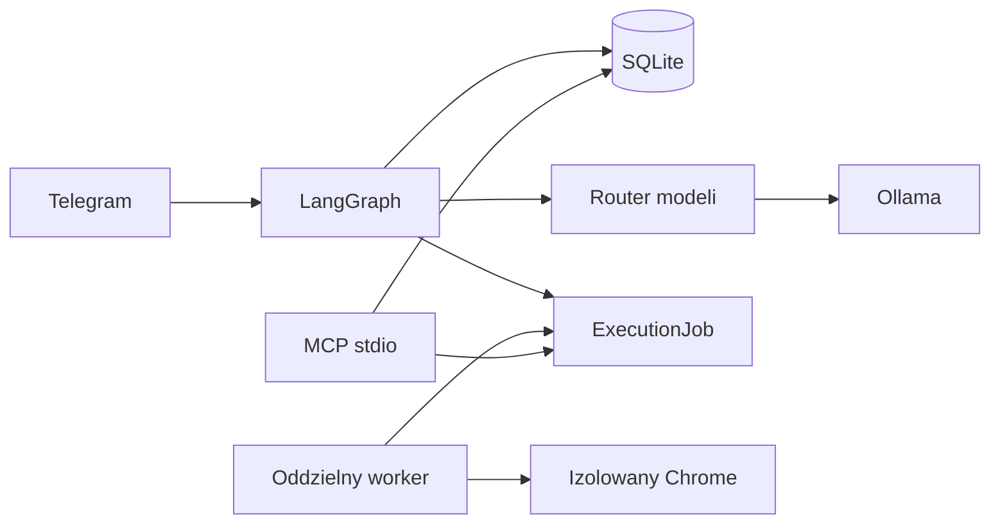
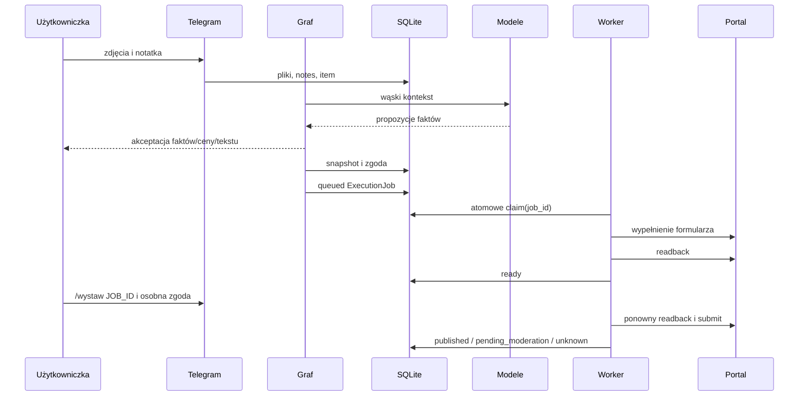

# Marketplace Listing Agent — podręcznik techniczny

Aktualne studium prostego przepływu wielu kategorii oraz eksperyment LoRA v2 opisuje
[`12_GENERALIZACJA_I_LORA_V2.md`](12_GENERALIZACJA_I_LORA_V2.md).
Domknięcie proweniencji, readbacku, stanów `unknown`, backupu i proxy opisuje
[`13_GOTOWOSC_OPERACYJNA.md`](13_GOTOWOSC_OPERACYJNA.md).

## Jak korzystać z materiału

Ten tekst nie służy do zapamiętywania każdej linii Pythona. Jego celem jest zbudowanie
modelu mentalnego systemu: jakie dane istnieją, kto może je zmienić, gdzie przebiega
granica zaufania, jak wykrywamy błąd i jaki dowód pozwala stwierdzić, że funkcja działa.
Najlepsza kolejność nauki to: przeczytać teorię modułu, przejść konkretny przykład,
uruchomić wskazany test, a następnie własnymi słowami wyjaśnić decyzję architektoniczną.

W projekcie rozróżniamy cztery poziomy dowodu:

1. **Unit** — mały fragment zachowuje się poprawnie dla danych kontrolowanych.
2. **Integration** — kilka prawdziwych komponentów współpracuje, np. graf, SQLite i
   checkpointer.
3. **Controlled browser** — kod działa na aktualnym formularzu w zalogowanej sesji,
   lecz zatrzymuje się przed konsekwencją zewnętrzną.
4. **Real portal** — dokładnie zaakceptowany przedmiot został rzeczywiście opublikowany,
   a wynik i recovery zostały sprawdzone.

Przejście testów unit nie jest dowodem poziomu czwartego. Taka dyscyplina języka jest
częścią pracy AI Engineera: odróżniać implementację, test, walidację i założenie.

## 0. Problem, autonomia i własność decyzji

System zamienia zdjęcia i krótkie notatki w propozycję faktów, prowadzi bezpieczny
research ceny, przygotowuje opis, pokazuje pełny podgląd, a następnie może wypełnić
formularz. Model ma rolę doradczą. Kod deterministyczny ustala uprawnienia, waliduje
dane i kontroluje działania przeglądarki. Użytkowniczka zatwierdza fakty, portal, cenę,
tekst i osobno publikację.

To podział według skutków błędu. Błąd stylistyczny w szkicu jest odwracalny. Kliknięcie
publikacji tworzy stan poza aplikacją, może kosztować pieniądze i nie da się go cofnąć
transakcją SQLite. Dlatego poziom autonomii maleje wraz z konsekwencją działania.

Na rozmowie można powiedzieć: „Zaprojektowałam model jako komponent proponujący, a nie
źródło autoryzacji. Uprawnienie do skutku zewnętrznego wynika z jednorazowej zgody
związanej z niezmiennym snapshotem”. To opis decyzji, której dowodem są tabele
`listing_snapshots`, `approval_records`, `execution_jobs` i testy ich niezmienników.

## 1. Mapa pojęć: proces, serwer, usługa, endpoint i adapter

**Proces** to uruchomiony program z własną pamięcią. Bot i worker mogą być osobnymi
procesami. Awaria workera nie powinna zniszczyć kontekstu rozmowy, ponieważ stan
utrwalono w SQLite.

**Usługa** oznacza odpowiedzialność logiczną. `MarketResearchService` organizuje
wyszukiwanie i weryfikację ofert. Usługa nie musi być osobnym serwerem.

**Serwer** czeka na żądania przez konkretny transport. Lokalny serwer MCP czeka na
komunikaty przez `stdio`. Ollama jest osobnym serwerem inferencji na komputerze.

**Endpoint** to nazwany punkt wejścia protokołu sieciowego, np. ścieżka HTTP. W tym
projekcie narzędzie MCP nie jest endpointem HTTP: pierwsza wersja działa po standardowym
wejściu i wyjściu procesu. To zmniejsza powierzchnię ataku i usuwa problem publicznego
nasłuchiwania.

**Adapter** tłumaczy kontrakt domenowy na szczegóły zewnętrznego systemu. OLX i Allegro
Lokalnie różnią się polami, rodzajem sprzedaży i przyciskami. Wspólny jest stan zadania,
ale selektory i reguły portalu pozostają w adapterze.

## 2. Pełny przepływ jednego przedmiotu

Zdjęcie zapisuje się w prywatnym katalogu aplikacji. Notatka trafia do
`conversation_notes`. Graf przekazuje modelowi obrazy i wąski kontekst tekstowy. Wynik
modelu przechodzi przez Pydantic, ale poprawny schemat nie oznacza prawdziwości.
Każdy proponowany fakt wymaga decyzji człowieka.

Po zatwierdzeniu faktów router wybiera role modelowe. Research traktuje internet jako
niezaufane wejście. Kandydat ceny musi przejść kontrolę URL, waluty, typu kwoty,
integralności źródeł, statusu ogłoszenia i porównywalności. Odrzucenie jest zapisywane
z kodem przyczyny. Model copywritera otrzymuje tylko zatwierdzone i zredagowane fakty.
Drugi audyt oraz reguły deterministyczne usuwają niepoparte twierdzenia.

Zatwierdzony draft i hashe bajtów zdjęć tworzą `ListingSnapshot`. Zmiana jednego bajtu
zdjęcia tworzy nową wersję. Zgoda na wypełnienie dotyczy listy identyfikatorów snapshotów.
Graf zapisuje zadania, a osobny worker otwiera trwały profil sprzedażowy. Po readback
zadanie ma status `ready`. Publikacja wymaga drugiej zgody i ponownego readbacku.

## 3. Python używany w projekcie

Pydantic definiuje kontrakty danych i wykonuje walidację przy granicy komponentów.
`PortalDraft.model_validate(...)` zamienia zwykły słownik z bazy w obiekt o sprawdzonych
typach. `model_dump(mode="json")` daje reprezentację możliwą do zapisania w checkpoint.

`async` służy tu do operacji oczekujących: modelu, sieci i przeglądarki. Nie powoduje
automatycznie równoległości. Research może wykonywać ograniczoną liczbę zadań
równocześnie, lecz formularze są sekwencyjne, ponieważ jeden profil Chrome jest
zasobem ze stanem.

Wyjątki są częścią kontraktu. `PermissionError` oznacza naruszenie warunku zgody,
`LookupError` brak jednoznacznej kontrolki, a typowany status `unknown` oznacza brak
dowodu wyniku po submit. W logach zapisujemy typ wyjątku, nie pełną treść, która mogłaby
zawierać dane użytkowniczki.

## 4. LangGraph: state, node, edge, interrupt i replay

`ListingState` jest serializowalnym stanem procesu. Node otrzymuje stan i zwraca jego
aktualizację. Edge opisuje dozwoloną kolejność. `interrupt()` utrwala pozycję i oddaje
sterowanie kanałowi użytkownika. `Command(resume=...)` wznawia wykonanie.

Kluczową cechą jest replay: node może zostać wykonany ponownie od początku. Kod przed
interruptem musi być deterministyczny lub idempotentny. Utworzenie snapshotu jest
content-addressed, a enqueue korzysta z idempotency key; ponowienie nie tworzy drugiej
kopii. Losowy token zgody powstaje poza logiką replay i jest zapisany w bazie.

Checkpoint odpowiada na pytanie „gdzie jest proces?”. Katalog domenowy odpowiada na
„jakie fakty, snapshoty i zgody istnieją?”. Rozdzielenie zapobiega uznaniu starego
checkpointu za aktualne uprawnienie.

Awaria do przećwiczenia: zatrzymaj proces na interrupt, uruchom ponownie i użyj `/status`.
Oczekiwany wynik to odtworzony przycisk z tokenem z SQLite, a nie utrata rozmowy.

## 5. SQLite: trwałość, transakcje i migracje

SQLite jest biblioteką w procesie, nie osobnym serwerem. Dane trafiają do pojedynczego
pliku bazy, ale transakcje i dziennik WAL zapewniają spójność przy współpracy bota i
workera. `BEGIN IMMEDIATE` pobiera blokadę zapisu zanim kod odczyta i zmieni zgodę lub
zadanie. Dzięki temu dwa procesy nie skonsumują tego samego tokenu ani nie przejmą
jednego joba.

Relacyjna kolumna przechowuje to, po czym pytamy i czym sterujemy: ID, status, czas,
portal. JSON przechowuje wersjonowany payload domenowy. Umieszczenie wszystkiego w JSON
utrudniłoby atomowe wyszukiwanie pending approvals; rozbicie każdej cechy produktu na
tabelę zwiększyłoby koszt zmian schematu. Projekt wybiera środek odpowiedni dla jednej
użytkowniczki.

Migracja podnosi `SCHEMA_VERSION` i idempotentnie dodaje brakujące elementy. `doctor`
sprawdza integralność oraz oczekiwaną wersję. Backup używa SQLite Backup API, więc nie
kopiuje przypadkowo pliku w połowie transakcji. Restore odmawia nadpisania niepustego
katalogu.

## 6. Modele, kontekst i routing

Model językowy jest stateless z perspektywy pojedynczego żądania. „Pamięć” powstaje,
gdy aplikacja ponownie dostarcza wybrane dane. W tym projekcie trwałe fakty i wydarzenia
są w SQLite, pozycja procesu w checkpointach, a prompt zawiera tylko dane potrzebne
danej roli. Pełna historia rozmowy nie jest bezrefleksyjnie doklejana.

Takie składanie kontekstu ogranicza tokeny, wyciek danych i ryzyko, że dawna sugestia
modelu stanie się rzekomym faktem. `confidence` modelu jest deklaracją modelu, nie
skalibrowanym prawdopodobieństwem. Źródło i akceptacja mają większe znaczenie.

Router mapuje role na modele: analiza obrazów, ekspert rynku, polski copywriter i
ograniczony fallback GUI. „Armia agentów” ma sens tylko wtedy, gdy rozdział ról daje
mierzalną jakość lub lepsze uprawnienia. Wiele nazw agentów korzystających z tej samej
pamięci i tych samych narzędzi nie tworzy realnej specjalizacji.

## 7. Trzy warstwy walidacji

Walidacja strukturalna odpowiada, czy wynik ma wymagane pola i typy. Walidacja
deterministyczna sprawdza niezmienniki: portal należy do allowlisty, cena jest dodatnia,
przycisk ma dokładną nazwę, zgoda odpowiada snapshotowi. Walidacja semantyczna bada,
czy opis ma oparcie w faktach; stosujemy model audytora i prostą niezależną regułę.

Poprawny JSON może zawierać fałsz. Z kolei tekst prawdziwy może nie spełniać kontraktu.
AI Engineer powinien projektować oba rodzaje kontroli i prowadzić system w trybie
fail closed: brak dowodu nie staje się sukcesem.

## 8. Research jako pipeline dowodowy

HTML, JSON-LD i metadata to trzy kanały obserwacji. Cena `10 zł` może oznaczać dostawę,
`100 zł x 12` ratę, a `1200 zł` cenę przedmiotu. Najpierw klasyfikujemy znaczenie i
walutę, potem porównujemy kanały, następnie oceniamy tożsamość produktu i dopiero na
końcu liczymy statystykę.

`is_pricing_eligible` jest wspólną bramką. Dzięki temu timeout nie uruchamia bocznej
ścieżki z łagodniejszymi zasadami. Aktywne ceny ofertowe i jawnie sprzedane rekordy są
oddzielone. Rekomendacja wynika z aktywnych ofert, ponieważ cena sprzedana może być
nieobserwowalna lub nieporównywalna.

Manifest dowodu zapisuje URL, kanały, wynik i kody odrzucenia bez pełnego HTML, cookie
oraz promptów. Pozwala odtworzyć decyzję i nie gromadzi nadmiarowych danych.

## 9. Bezpieczeństwo AI i sieci

Prompt injection na stronie jest treścią dowodową, a nie instrukcją dla procesu.
Research nie ma narzędzia publikacji. Model formularza może wybrać tylko jedną dokładnie
widoczną kontrolkę z allowlisty i nie może wskazać submit.

SSRF powstaje, gdy niezaufany URL skłania aplikację do połączenia z zasobem, którego
atakujący sam nie widzi. Walidacja odrzuca dane logowania w URL, nietypowe porty,
localhost, adresy prywatne, link-local i specjalne IPv4/IPv6. Kontenerowy proxy rozwiązuje
DNS i łączy się z tym samym zweryfikowanym IP, co ogranicza DNS rebinding.

Profil sprzedażowy jest odseparowany od osobistego Chrome. Hasła i OTP wpisuje się
bezpośrednio w portalu. 2FA nie chroni przed skradzionym ważnym cookie, dlatego profil,
uprawnienia katalogów i brak jego montowania do kontenera nadal mają znaczenie.

Threat model nie obiecuje ochrony po pełnym przejęciu systemu macOS. Chroni przed
konkretnymi błędami aplikacji, nie przed administratorem złośliwie kontrolującym hosta.

## 10. Snapshot, zgoda i idempotency

Snapshot jest niezmiennym opisem tego, co ma zostać wykonane: draft, zatwierdzone fakty,
ustawienia transakcji oraz uporządkowane hashe zdjęć. Content hash pozwala rozpoznać
identyczną wersję. Zgoda przechowuje hash payloadu, użytkownika, krok, przedmiot,
snapshoty i czas wygaśnięcia.

Idempotency oznacza, że ponowienie tego samego żądania nie tworzy drugiego lokalnego
zadania. Nie gwarantuje exactly-once na portalu, który nie przyjmuje naszego klucza.
Po timeout submit wynik brzmi `unknown`. Reconciliation najpierw szuka skutku i nie
klika ponownie.

## 11. Automatyzacja przeglądarki i interwencje

Playwright steruje kontrolkami przez ich semantyczne etykiety. Exact matching i warunek
jednego elementu blokują przypadkowe kliknięcie podobnego przycisku. Po wypełnieniu
readback porównuje wartość DOM ze snapshotem. Screenshot jest dowodem diagnostycznym,
ale może zawierać dane prywatne i pozostaje lokalny.

CAPTCHA jest mechanizmem kontroli portalu. System tworzy `InterventionRequest`, zostawia
okno otwarte i nie próbuje obchodzić zabezpieczenia. Wznowienie ponownie sprawdza
przeszkodę. Ten sam mechanizm obsługuje logowanie, nieznane pole, ręczną zmianę oraz
opłatę.

## 12. Monitoring bez nadmiernego zbierania danych

`RunEvent` przechowuje model, rolę, czas, liczbę tokenów, fallback, typ błędu oraz hash
system promptu. Nie przechowuje promptu, opisu, obrazów, cookie ani tokenów. Lokalny
raport HTML używa allowlisty pól i escapuje HTML.

Monitoring odpowiada „co i gdzie zawiodło”, a nie „zbierzmy wszystko”. Brak surowego
promptu ogranicza debugowanie konkretnej treści, lecz projekt świadomie preferuje
minimalizację danych. Gdy potrzebny jest kontrolowany debug, powinien być osobnym,
czasowym trybem z redakcją.

## 13. Ewaluacja i golden dataset

Golden dataset jest zbiorem wejść z uzasadnionym oczekiwaniem. Zawiera przypadki
zwykłe, graniczne i bezpieczeństwa. Raport zapisuje hash zbioru, konfiguracji, commit,
środowisko i liczebność. Fallback jest podczas benchmarku wyłączony, inaczej pozornie
ten sam model mógłby uzyskać wynik od zastępcy.

Leakage pojawia się, gdy niemal identyczny przykład trafia do train i test. Eksperyment
LoRA dzieli dane po rodzinie produktu. Zamrożony test nie zmienia się po zobaczeniu
wyniku. Metryki obejmują osobne właściwości, zamiast jednej „magicznej” liczby.

## 14. Git i CI

Commit jest nazwanym snapshotem kodu. Branch pozwala rozwijać zmianę bez przesuwania
głównej linii. Pull request służy do przeglądu różnicy i uruchamia CI. Revert tworzy
nowy commit odwracający zmianę; nie usuwa historii.

GitHub Actions po każdym pushu i PR uruchamia Ruff, pytest, walidację JSONL, skaner
sekretów, budowę wheel, smoke test poza checkoutem i audyt zależności. To automatyczne
testowanie w GitHubie. Nie dowodzi działania zalogowanego OLX, GPU MLX ani Chrome na
macOS, ponieważ runner CI ich nie posiada.

## 15. Eksploatacja i recovery

`doctor` ma zakresy core, Telegram, models, browser i research. Błąd daje niezerowy exit code,
więc może zatrzymać instalację lub automatyzację. Dane aplikacji żyją poza repozytorium.
LaunchAgent wskazuje zainstalowany executable, nie przypadkowe `.venv` developera.

Backup obejmuje obie bazy, zdjęcia, konfiguracje i manifest SHA-256. Restore odbywa się do nowego katalogu, po czym
uruchamia się `doctor`, testuje status i dopiero ręcznie przełącza konfigurację. Taki
dry run ogranicza ryzyko utraty jedynej działającej kopii.

## 16. Docker i granica izolacji

Obraz to niezmienny zestaw plików i zależności. Kontener jest procesem uruchomionym z
tego obrazu. Wolumen dostarcza jawnie wybrane dane, a sieć definiuje osiągalne usługi.

Proxy projektu działa jako nieuprzywilejowany użytkownik, z read-only root,
`no-new-privileges`, bez capabilities i z limitami pamięci. Research Chrome działa na
Macu, lecz wymaga tego proxy, które odrzuca adresy prywatne i specjalne.

Docker Desktop na macOS działa wewnątrz maszyny wirtualnej. Test integracyjny potwierdził
publiczny HTTPS przez proxy i odmowę dla localhost. Jest to granica egressu, a nie
filesystem sandbox procesu Chrome.

## 17. MCP

Model Context Protocol standaryzuje sposób, w jaki host odkrywa i wywołuje zasoby oraz
narzędzia serwera. MCP nie jest modelem, agentem ani sandboxem. Uprawnienia muszą być
egzekwowane przez aplikację.

Serwer tego projektu działa lokalnie przez `stdio`. Narzędzia odczytują status,
zatwierdzony snapshot i podsumowanie ceny. Narzędzia wykonawcze przyjmują `job_id`, nie
nowy opis, cenę, hasło, OTP lub cookie. Serwer ponownie sprawdza bazę i zapisuje audit
event. Dzięki temu MCP jest drugim interfejsem do tej samej logiki domenowej.

## 18. Fine-tuning i LoRA

Supervised fine-tuning minimalizuje stratę przewidywania poprawnej odpowiedzi dla par
wejście–odpowiedź. LoRA nie aktualizuje pełnej macierzy `W`; uczy niskorangową zmianę
`ΔW = B·A`. Liczba parametrów i stan optymalizatora są dzięki temu znacznie mniejsze.

W drugim eksperymencie użyto 400 przykładów train, 100 validation i 100 frozen test z
całymi rodzinami produktów wyłączonymi z treningu. Adaptery nauczyły się prozy, ale
pokrycie dokładnych faktów spadło do około 0,81, a nazwa przedmiotu była zachowana w
połowie przypadków. Dlatego nie zostały wdrożone do produktu.

## 19. Obrona projektu

### Wersja 60 sekund

„Zbudowałam lokalnego agenta do przygotowania polskich ogłoszeń. LangGraph prowadzi
jawny proces z akceptacją faktów, ceny i tekstu. Research ceny jest evidence-based:
rozróżnia walutę i rodzaj kwoty, porównuje kanały danych i zapisuje przyczyny odrzucenia.
SQLite przechowuje fakty, niezmienne snapshoty, jednorazowe zgody i idempotentne zadania.
Oddzielny worker steruje izolowanym profilem Chrome; CAPTCHA i opłaty powodują pauzę.
Monitoring nie zapisuje promptów ani sekretów. Dodałam CI, MCP i kontrolowany eksperyment
LoRA, którego wynik porównałam z modelem bazowym i szablonem”.

### Pytania kontrolne

- Dlaczego checkpoint nie wystarcza jako źródło zgody?
- Co chroni `BEGIN IMMEDIATE` przy dwóch workerach?
- Dlaczego poprawny model Pydantic nie potwierdza prawdziwości?
- Kiedy idempotency nie daje exactly-once?
- Dlaczego MCP nie jest granicą bezpieczeństwa?
- Dlaczego LoRA nie została automatycznie wdrożona mimo bardzo dobrego testu?

Pełna odpowiedź powinna wskazać mechanizm, alternatywę, dowód z testu i ograniczenie.

## Słownik skrócony

- **HITL** — człowiek podejmuje wskazaną decyzję w procesie.
- **Readback** — ponowny odczyt wartości ze źródła po zapisie.
- **Fail closed** — brak pewności prowadzi do odmowy lub pauzy.
- **Idempotency key** — klucz rozpoznający lokalne powtórzenie tej samej operacji.
- **Reconciliation** — ustalenie rzeczywistego skutku po niepewnym wyniku.
- **SSRF** — wykorzystanie serwera do połączenia z niedostępnym dla atakującego adresem.
- **Prompt injection** — treść próbująca zmienić instrukcje modelu lub użycie narzędzi.
- **Golden dataset** — wersjonowany zestaw przypadków z oczekiwanym wynikiem.
- **LoRA** — strojenie przez niskorangową zmianę wybranych macierzy modelu.
- **MCP** — protokół udostępniania narzędzi i kontekstu hostowi AI.
